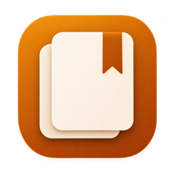
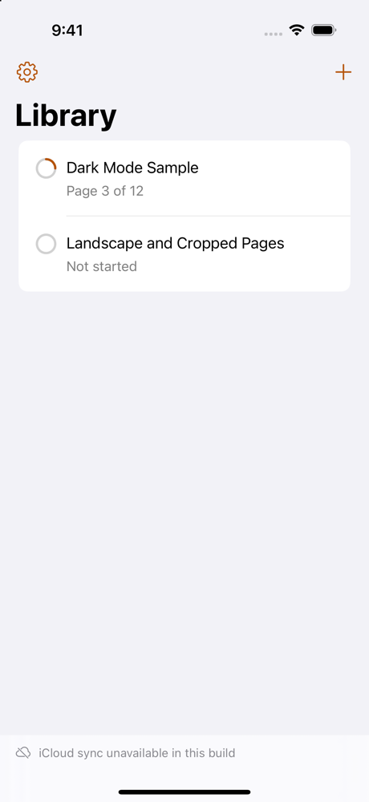
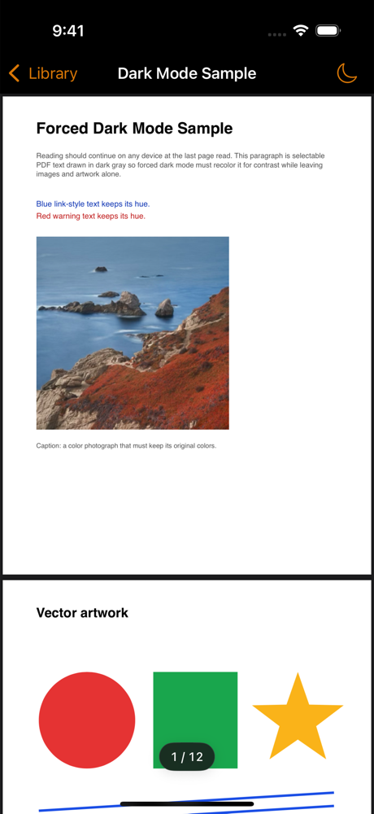
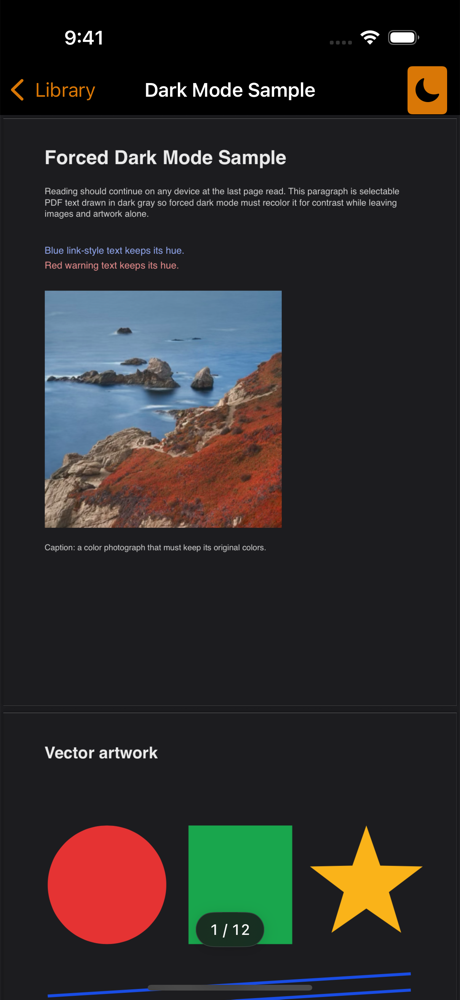
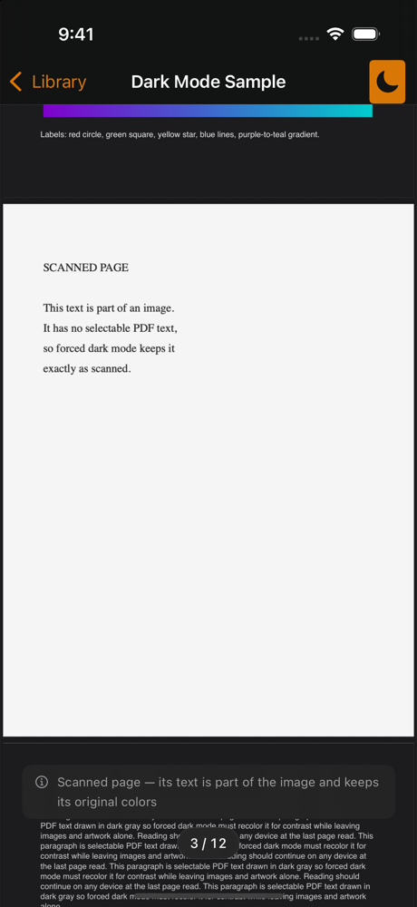
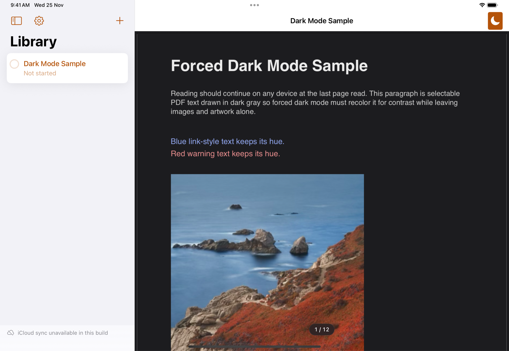
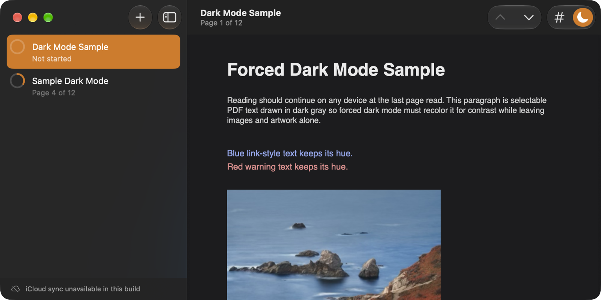

# PDF Library

A native PDF reader for Mac, iPhone and iPad with one private iCloud library. Every device keeps its own copy of every PDF, so you can read offline. Each PDF reopens at the last page you read on any device. It also has a forced PDF dark mode that turns text light but keeps photos and artwork in their original colors.

SwiftUI and PDFKit, with no third-party dependencies, backend, analytics or accounts. Sync uses only your own iCloud private database.

<p>




</p>





## Features

**Library**
- Import PDFs with the system file picker (several at once), by dragging from Finder onto the Mac window, or with Open in / Share → PDF Library on iPhone and iPad. The app keeps its own copy and never changes the original.
- Invalid or password-protected files are rejected with a clear message. Importing the same PDF twice is detected.
- Rename and delete (with confirmation) from the context menu, swipe actions or the Mac Edit menu.
- Each row shows reading progress and its iCloud status: uploading, waiting to download, downloaded, or an error with Retry.

**Reading**
- Opens at the last page read on any device. Just opening a PDF never overwrites newer progress, and turning back to an earlier page on purpose does count.
- iPhone: a full-screen reader. Tap to hide the bars; the page indicator stays visible. iPad: split view with the library beside the reader. Mac: sidebar and reader with menus and shortcuts for next/previous/first/last page, Go to Page (⌥⌘G), zoom (⌘+ ⌘− ⌘0 ⌘9) and dark mode (⇧⌘D).

**iCloud sync** (CloudKit private database via `CKSyncEngine`)
- Every PDF downloads to every device automatically. Downloads resume after reconnecting or relaunching, and failures stay visible until a retry succeeds.
- Renames and reading positions sync as small separate records, so the PDF itself is uploaded only once.
- Deleting wins over stale edits made offline on another device.
- Each iCloud account gets its own library. Signing out or switching accounts never mixes libraries.
- Reading and importing keep working offline. Changes sync later, and your latest position is sent as the app goes to the background.

**Appearance**
- Appearance setting: System, Light or Dark for the whole app.
- **Force PDF Dark Mode**: a separate, persistent reader setting that works even in Light appearance. It recolors the PDF's own text drawing operators to light colors with the same hue. Photos, vector artwork and scanned pages keep their original colors. It is not a page inversion or color filter. Pages it can't reproduce faithfully are shown in their original colors, with a note. See [docs/DARK_MODE.md](docs/DARK_MODE.md).

## Build

Requires Xcode 27 or later (iOS 18 / macOS 15 deployment) and [XcodeGen](https://github.com/yonaskolb/XcodeGen).

```sh
xcodegen generate
# Without an Apple Developer team (no iCloud; runs as a local library):
xcodebuild -project PDFLibrary.xcodeproj -scheme PDFLibraryMac -destination 'platform=macOS' CODE_SIGNING_ALLOWED=NO PDFL_CLOUD_SYNC=NO build
xcodebuild -project PDFLibrary.xcodeproj -scheme PDFLibraryiOS -destination 'generic/platform=iOS Simulator' CODE_SIGNING_ALLOWED=NO PDFL_CLOUD_SYNC=NO build
```

To use iCloud sync with your own team, change `DEVELOPMENT_TEAM`, the bundle identifier and the iCloud container in `project.yml` and `PDFLibrary/Sync/CloudRecords.swift`, then follow [docs/SIGNING.md](docs/SIGNING.md).

- Sync design and CloudKit schema: [docs/CLOUDKIT.md](docs/CLOUDKIT.md)
- Forced dark mode: [docs/DARK_MODE.md](docs/DARK_MODE.md)
- Device test checklist: [docs/RUNBOOK.md](docs/RUNBOOK.md)

iCloud sync has been checked live between an iPhone and a Mac (a PDF and its reading position). The full multi-device checklist is in [docs/RUNBOOK.md](docs/RUNBOOK.md).

Screenshots use a synthetic sample PDF. They come from a simulator build without iCloud, which is why the footer says sync is unavailable.

## License

[MIT](LICENSE)
